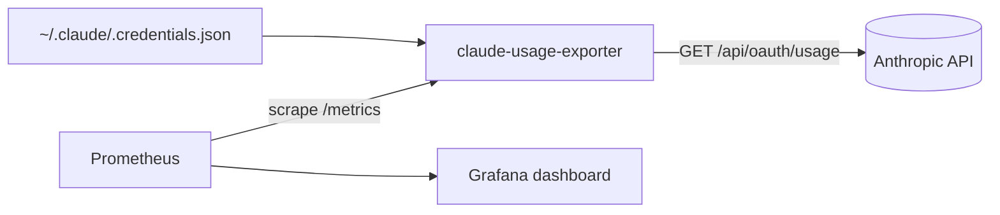

# claude-usage-exporter: summary

A Prometheus exporter for Claude plan usage windows (the numbers `/usage` shows in the Claude CLI)
and the health of the CLI's login. Standard library Python only. It reads the CLI's existing OAuth
credentials file and calls the usage endpoint; it never refreshes the token (the CLI does) and never
exports or logs it.

## State (0.1.1)

- One process serves `/metrics` and `/healthz`. Each upstream result is cached (`CLAUDE_USAGE_CACHE`)
  so scrapes don't hammer the API.
- Unknown response fields are ignored. A response with the wrong shape logs
  `unexpected usage response shape` and reports `claude_usage_up 0` rather than crashing.
- Shipped as a native Debian package (arch all, opt-in systemd user unit plus a
  `claude-usage-exporter@<user>` system template), a multi-arch GHCR image, and the Grafana dashboard
  as a release asset.
- Releases: signed tag; draft release built by CI; `SHA256SUMS` signed with the maintainer key;
  then published. `releases/latest` only ever returns signed releases.

